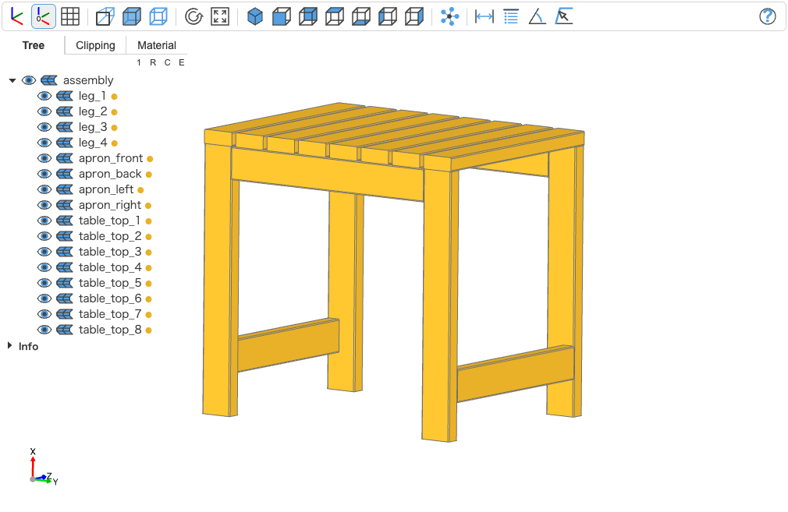

# nichiyou-daiku (日曜大工)

[](https://github.com/ar90n/nichiyou-daiku/actions/workflows/ci.yml)
[](https://codecov.io/gh/ar90n/nichiyou-daiku)
[](https://www.python.org/downloads/)
[](https://www.apache.org/licenses/LICENSE-2.0)


A domain-specific CAD system for DIY woodworking, built on the [MO-CAD (Manufacturing Oriented CAD)](https://caddi.tech/archives/4104) concept. Design furniture using a simple DSL that represents real-world construction techniques with standard lumber sizes.

Following the "Worse Is Better" philosophy, nichiyou-daiku prioritizes practical usability over theoretical perfection, making it easy to design and build furniture that can actually be constructed with common tools and materials.

## Quick Example

Design a simple table (800 x 600 x 758 mm) using our DSL

```nd
// Simple Table Design with Comments
// Author: nichiyou-daiku team
// Date: 2025-07-30

// Define the four legs of the table
// Each leg is 720mm tall
(leg_1:2x4 =720)  // Front left leg
(leg_2:2x4 =720)  // Front right leg
(leg_3:2x4 =720)  // Back left leg
(leg_4:2x4 =720)  // Back right leg

// Define the aprons that connect the legs
// These provide structural support
(apron_front:2x4 =622)  // Front apron
(apron_back:2x4 =622)   // Back apron
(apron_left:2x4 =524)   // Left side apron
(apron_right:2x4 =524)  // Right side apron

// Define the table top
(table_top_1:2x4 =600)
(table_top_2:2x4 =600)
(table_top_3:2x4 =600)
(table_top_4:2x4 =600)
(table_top_5:2x4 =600)
(table_top_6:2x4 =600)
(table_top_7:2x4 =600)
(table_top_8:2x4 =600)

// Front apron connections
leg_1 -[LB>0 DB>0]- apron_front
leg_2 -[RF>0 TF>0]- apron_front

// Back apron connections
leg_3 -[LB>0 DB>0]- apron_back
leg_4 -[RF>0 TF>0]- apron_back

// Side apron connections
leg_1 -[BR<100 DB<0]- apron_left
leg_3 -[FR<100 TB<0]- apron_left
leg_2 -[BL<100 DF<0]- apron_right
leg_4 -[FL<100 TF<0]- apron_right

// Table top connections
table_top_1 -[BD<0 TF<0]- leg_1
apron_front -[RF<12.571 BT<0]- table_top_2
apron_front -[RF<114.142 BT<0]- table_top_3
apron_front -[RF<215.713 BT<0]- table_top_4
apron_front -[RF<317.284 BT<0]- table_top_5
apron_front -[RF<418.855 BT<0]- table_top_6
apron_front -[RF<520.426 BT<0]- table_top_7
table_top_8 -[BD<0 TF<0]- leg_2
```

View results with ocp-viewer

```bash
$ nichiyou-daiku view examples/nd_files/simple_table_compact.nd
```



Generate a report with material list and cut optimization

```bash
$ nichiyou-daiku report examples/nd_files/simple_table_compact.nd -o table_report.md --no-anchor-details --no-pilot-holes
```

The generated report is following (without the two flags, the report also lists every anchor and pilot hole per piece). The cut list allows 3mm of saw kerf per cut and warns about pieces longer than any stock board.

```markdown
# Woodworking Project Report

*Generated on 2026-10-10 17:00*

## Project Overview

- **Total Pieces**: 16
- **Lumber Types**: 1 (2x4)
- **Total Volume**: 33,725,304 mm³
- **Estimated Weight**: ~16.9 kg (assuming pine density)


## Bill of Materials

| ID | Type | Length (mm) | Width (mm) | Height (mm) | Volume (mm³) |
|----|------|------------|-----------|------------|-------------|
| apron_left | 2x4 | 524 | 89 | 38 | 1,772,168 |
| apron_right | 2x4 | 524 | 89 | 38 | 1,772,168 |
| table_top_1 | 2x4 | 600 | 89 | 38 | 2,029,200 |
| table_top_2 | 2x4 | 600 | 89 | 38 | 2,029,200 |
| table_top_3 | 2x4 | 600 | 89 | 38 | 2,029,200 |
| table_top_4 | 2x4 | 600 | 89 | 38 | 2,029,200 |
| table_top_5 | 2x4 | 600 | 89 | 38 | 2,029,200 |
| table_top_6 | 2x4 | 600 | 89 | 38 | 2,029,200 |
| table_top_7 | 2x4 | 600 | 89 | 38 | 2,029,200 |
| table_top_8 | 2x4 | 600 | 89 | 38 | 2,029,200 |
| apron_front | 2x4 | 622 | 89 | 38 | 2,103,604 |
| apron_back | 2x4 | 622 | 89 | 38 | 2,103,604 |
| leg_1 | 2x4 | 720 | 89 | 38 | 2,435,040 |
| leg_2 | 2x4 | 720 | 89 | 38 | 2,435,040 |
| leg_3 | 2x4 | 720 | 89 | 38 | 2,435,040 |
| leg_4 | 2x4 | 720 | 89 | 38 | 2,435,040 |


## Shopping List

### Lumber Required:

- **2x4**: 16 pieces, total 10.0 meters


## Purchase Recommendations

### 2x4 Lumber (Available: 2440mm, 3050mm, 3660mm)
Optimal purchase:
- 3 × 2440mm boards
- 1 × 3660mm boards
Total waste: 960mm (8.7%)

## Optimized Cut List

### 2x4 Boards

**Board 1** (3660mm):
- Cut 720mm → leg_1
- Cut 720mm → leg_2
- Cut 720mm → leg_3
- Cut 720mm → leg_4
- Cut 622mm → apron_front
- Waste: 143mm

**Board 2** (2440mm):
- Cut 622mm → apron_back
- Cut 600mm → table_top_1
- Cut 600mm → table_top_2
- Cut 600mm → table_top_3
- Waste: 6mm

**Board 3** (2440mm):
- Cut 600mm → table_top_4
- Cut 600mm → table_top_5
- Cut 600mm → table_top_6
- Cut 600mm → table_top_7
- Waste: 28mm

**Board 4** (2440mm):
- Cut 600mm → table_top_8
- Cut 524mm → apron_left
- Cut 524mm → apron_right
- Waste: 783mm

---
*Report generated by nichiyou-daiku*
```

## Features

### DSL & CLI Tools
- 📝 Simple, readable DSL for furniture design
- 🛠️ Command-line tools for validation, reporting, and 3D export
- 📊 Automatic bill of materials generation
- 📐 Cut optimization to minimize waste
- 📑 Markdown reports with shopping lists
- 🎯 Export to STL/STEP for 3D printing or CNC

### Core Library
- 🪵 Support for standard lumber sizes (2x4 and 1x4)
- 🔗 Flexible connection system with precise offset control
- 🔩 Dowel and screw joint support with preset sizes
- 📐 3D visualization with build123d (optional)
- 🧩 Piece-oriented design matching real woodworking
- 📊 Graph-based assembly representation
- 🎯 Type-safe Python API with full type hints

## Installation

```bash
# Basic installation
pip install nichiyou-daiku

# With visualization support
pip install "nichiyou-daiku[viz]"

# Development installation with uv
uv pip install -e ".[viz]"
```

> **Note** The visualization feature requires build123d, which currently has limited support for ARM64/aarch64 platforms. Core functionality works on all platforms.

## Development

### Setup

This project uses [uv](https://github.com/astral-sh/uv) for dependency management.

```bash
# Clone the repository
git clone https://github.com/ar90n/nichiyou-daiku.git
cd nichiyou-daiku

# Install development dependencies
uv sync --dev

# Install with visualization support
uv sync --all-extras
```

### Running Tests

```bash
# Run tests with coverage
uv run pytest --cov=nichiyou_daiku --cov-report=term-missing

# Run specific test file
uv run pytest tests/core/test_piece.py -v

# Run with doctest
uv run python -m doctest src/nichiyou_daiku/core/piece.py
```

### Code Quality

```bash
# Format code
uv run ruff format src/ tests/

# Lint code
uv run ruff check src/ tests/

# Type checking
uv run pyright src/

# Run all checks
make lint
```

### Quality Assurance

This project uses Dagger for CI/CD pipelines. The Quality Assurance pipeline includes

- ✅ **Testing**: pytest with 90% minimum coverage + docstring tests
- 🎨 **Code Formatting**: ruff formatter
- 🔍 **Linting**: ruff static analysis
- 🏷️ **Type Checking**: pyright type verification
- 📦 **Building**: Python package distribution

#### Running QA Locally

```bash
make ci-local
```

#### GitHub Actions

The Quality Assurance pipeline automatically runs on
- Push to main branch
- Pull requests
- Manual workflow dispatch

See the [ci/](ci/) directory for pipeline implementation details.

## Examples

Check out the `examples/` directory for complete working examples

- **`simple_table.py`** - A basic four-legged table demonstrating fundamental connections
- **`basic_joints.py`** - Different joint types (T-joint, butt joint, corner joint)
- **`corner_angle.py`** - Complex corner connections with precise angle control
- **`utils.py`** - Helper functions for creating common structures
- **`resource_demo.py`** - Demonstrates resource extraction and bill of materials
- **`report_demo.py`** - Shows report generation with cut optimization

### Visualizing with build123d

```python
from pathlib import Path

from nichiyou_daiku.dsl import parse_dsl
from nichiyou_daiku.core.assembly import Assembly
from nichiyou_daiku.shell import assembly_to_build123d
from ocp_vscode import show

# Load a model and convert it to a 3D assembly
model = parse_dsl(Path("examples/nd_files/simple_table_compact.nd").read_text())
assembly = Assembly.of(model)
compound = assembly_to_build123d(assembly)

# Visualize in OCP CAD Viewer
show(compound)
```

### Resource Extraction

Extract bill of materials from your models to understand lumber requirements

```python
from pathlib import Path

from nichiyou_daiku.dsl import parse_dsl
from nichiyou_daiku.core.assembly import Assembly
from nichiyou_daiku.shell.resources import extract_resources

# Extract resources from an assembly
model = parse_dsl(Path("examples/nd_files/simple_table_compact.nd").read_text())
assembly = Assembly.of(model)
resources = extract_resources(assembly)

# Get summary information
print(resources.pretty_print())
# Output: piece counts, total lengths by type, volume

# Export as JSON
json_data = resources.model_dump_json(indent=2)

# Access detailed information
for piece_type, count in resources.pieces_by_type.items():
    total_length = resources.total_length_by_type[piece_type]
    print(f"{piece_type.value}: {count} pieces, {total_length}mm total")
```

### Report Generation

Generate comprehensive markdown reports with shopping lists and cut optimization:

```python
from nichiyou_daiku.core.piece import PieceType
from nichiyou_daiku.shell.report_generator import generate_markdown_report

# Generate report (resources from the previous example) with custom standard lengths
custom_lengths = {
    PieceType.PT_2x4: [2400.0, 3000.0, 3600.0],  # metric lengths
    PieceType.PT_1x4: [1800.0, 2400.0, 3000.0],
}

report = generate_markdown_report(
    resources,
    project_name="My Table Project",
    standard_lengths=custom_lengths,
    include_cut_diagram=True
)

# Save report
with open("project_report.md", "w") as f:
    f.write(report)
```

The report includes:
- Project overview with total materials needed
- Detailed bill of materials table
- Shopping list aggregated by lumber type
- Purchase recommendations with optimal board usage
- Cut diagrams showing how to minimize waste (3mm saw kerf per cut, with a warning for pieces longer than any stock board)
- Anchor positions and pilot holes for each piece (can be turned off)

### DSL Support (Domain-Specific Language)

nichiyou-daiku supports a Cypher-inspired DSL for more concise model definitions

```nd
// Simple shelf design with comments: 676 x 89 x 800 mm
(left_side:2x4 =800)    // 800mm tall
(right_side:2x4 =800)
(shelf_low:2x4 =600)    // 600mm wide shelves
(shelf_high:2x4 =600)

// Connections using compact notation
left_side -[BL<300 DL<0 D(:8x30)]- shelf_low           // Dowel preset (8mm x 30mm)
right_side -[FL<300 TL<0 D(4, 30)]- shelf_low          // Dowel custom: radius 4mm, total length 30mm
shelf_high -[DL<0 BL>38 S(Slim:3.8x65)]- left_side     // Screw preset, driven through left_side
shelf_high -[TL<0 FL>38 S(Coarse:3.8x57)]- right_side  // Coarse thread screw preset
```

#### How Connections Work

Each piece is a box in its own frame: X = width (89mm), Y = thickness (38mm for 2x4, 19mm for 1x4), Z = length.

| Face | Letter | Kind |
|------|--------|------|
| top / down | `T` / `D` | the two end faces (89 x thickness) |
| front / back | `F` / `B` | the two wide faces (89 x length) |
| right / left | `R` / `L` | the two narrow faces (thickness x length) |

An anchor such as `FL<100` names a contact face (`F`), an adjacent edge-shared face (`L`) and an offset along the edge where the two faces meet. `<v` is measured from the down end / left side / back side, `>v` from the top end / right side / front side. A connection `base -[A B]- target` places the target so that:

1. the two contact faces touch face to face,
2. the two edge-shared faces lie in one plane facing the same way (flush), and
3. the two anchor points coincide.

For example, with a 2x4 leg (700mm) standing on the floor, `leg -[FL<100 DF<0]- apron` puts the apron's down end against the leg's front face, flush with the leg's left face, with the apron's 89mm width hanging just below the point 100mm above the floor (z = 11..100).

#### DSL Features

- **Comments**: Single-line comments with `//`
- **Compact piece syntax**: `(id:type =length)` instead of JSON
- **Compact connection syntax**: `-[TF<0 BD<0]-` for two face+face+offset anchors
- **Face abbreviations**: T(op), D(own), L(eft), R(ight), F(ront), B(ack) - `B` is back, not bottom
- **Connection types**:
  - `V` - Vanilla connection (default)
  - `D(radius, length)` - Dowel joint with custom dimensions (total length; half goes into each piece)
  - `D(:8x30)` - Dowel joint using preset (diameter x length)
  - `S(diameter, length)` - Screw joint with custom dimensions
  - `S(Slim:3.3x50)` - Slim screw preset
  - `S(Coarse:3.8x57)` - Coarse thread screw preset

See [docs/dsl-specification.md](docs/dsl-specification.md) for the full specification.

#### DSL CLI Tools

```bash
# Validate the model: syntax, contradicting connections, unconnected or
# overlapping pieces, and fasteners that do not fit or whose holes collide
# (no build123d needed)
nichiyou-daiku validate furniture.nd

# Generate markdown report (the overview includes the overall size X × Y × Z)
nichiyou-daiku report furniture.nd -o report.md

# View 3D model (requires build123d)
nichiyou-daiku view furniture.nd

# Export to STL/STEP formats
nichiyou-daiku export furniture.nd -f stl
nichiyou-daiku export furniture.nd -o model.step --fillet-radius 10

# Technical drawing PDF (requires build123d)
nichiyou-daiku drawing furniture.nd -o furniture.pdf
```

Commands other than `validate` print a warning and carry on when connections contradict each other, some pieces are not connected, or fasteners do not fit; `report` also lists these problems in the report itself.

See the `examples/nd_files/` directory for complete DSL examples.

## Python API

For programmatic access, you can use the Python API directly

```python
from nichiyou_daiku.core.piece import Piece, PieceType
from nichiyou_daiku.core.model import Model
from nichiyou_daiku.core.anchor import Anchor, BoundAnchor
from nichiyou_daiku.core.connection import Connection
from nichiyou_daiku.core.assembly import Assembly
from nichiyou_daiku.core.geometry import FromMin

# Create lumber pieces
horizontal_beam = Piece.of(PieceType.PT_2x4, 800.0, "beam")
vertical_post = Piece.of(PieceType.PT_2x4, 400.0, "post")

# T-joint: the post's down end butts against the beam's front face,
# 300mm from the beam's down end (DSL: beam -[FL<300 DF<0]- post)
connection = Connection(
    base=BoundAnchor(
        piece=horizontal_beam,
        anchor=Anchor(
            contact_face="front",
            edge_shared_face="left",
            offset=FromMin(value=300)
        )
    ),
    target=BoundAnchor(
        piece=vertical_post,
        anchor=Anchor(
            contact_face="down",
            edge_shared_face="front",
            offset=FromMin(value=0)
        )
    )
)

# Create a model with connected pieces
model = Model.of(
    pieces=[horizontal_beam, vertical_post],
    connections=[connection]
)
assembly = Assembly.of(model)
```

See [docs/api-specification.md](docs/api-specification.md) for the full API.

## Project Structure

```
nichiyou-daiku/
├── src/
│   └── nichiyou_daiku/
│       ├── core/           # Core data models
│       │   ├── piece.py    # Lumber piece definitions
│       │   ├── anchor.py   # Anchor / BoundAnchor (connection points)
│       │   ├── model.py    # Assembly graph model
│       │   ├── connection.py # Connection specifications
│       │   ├── dowel.py, screw.py # Fastener presets
│       │   ├── placement.py # Piece placement solver
│       │   ├── assembly/   # Assembly: placement, fasteners, pilot holes
│       │   │   ├── models.py # Hole, Fastener, LayoutIssue
│       │   │   ├── fasteners.py # Dowel/screw layout in the contact area
│       │   │   └── builder.py
│       │   └── geometry/   # Geometric primitives
│       │       ├── box.py, face.py, edge.py, corner.py
│       │       ├── coordinates.py, dimensions.py
│       │       └── offset.py
│       ├── dsl/            # DSL parser and transformer
│       │   ├── parser.py   # Lark-based DSL parser
│       │   ├── grammar.py  # DSL grammar definition
│       │   └── transformer.py # AST to model conversion
│       ├── cli/            # Command-line interface
│       │   ├── dsl_cli.py  # Main CLI entry point
│       │   └── commands/   # CLI commands
│       │       ├── validate.py, report.py
│       │       ├── view.py, export.py, drawing.py
│       └── shell/          # External integrations
│           ├── build123d_export.py
│           ├── drawing.py
│           ├── resources.py
│           ├── cutting.py
│           └── report_generator.py
├── examples/               # Example projects
│   ├── *.py               # Python examples
│   └── nd_files/*.nd      # DSL examples
├── tests/                  # Test suite
└── ci/                     # CI/CD pipeline (Dagger)
```

## Contributing

1. Fork the repository
2. Create a feature branch (`git checkout -b feature/amazing-feature`)
3. Write tests first (TDD approach)
4. Implement your feature
5. Run quality checks (`make lint` or `uv run ruff check`)
6. Commit your changes (`git commit -m 'feat: Add amazing feature'`)
7. Push to the branch (`git push origin feature/amazing-feature`)
8. Open a Pull Request

### Pull Request Guidelines

To ensure your contributions are properly categorized in release notes, please follow these PR title conventions

#### PR Title Format
Your PR title should follow the pattern `<type>: <description>`

- **feat:** New features or functionality
  - Example: `feat: Add support for 1x4 lumber sizes`
- **fix:** Bug fixes
  - Example: `fix: Correct joint position calculation for angled connections`
- **docs:** Documentation updates
  - Example: `docs: Add assembly guide for complex joints`
- **refactor:** Code restructuring without changing functionality
  - Example: `refactor: Simplify connection validation logic`
- **style:** Code style/formatting changes
  - Example: `style: Apply consistent naming to geometry modules`
- **chore:** Maintenance tasks, dependency updates
  - Example: `chore: Update pydantic to 2.12.0`
- **test:** Test additions or modifications
  - Example: `test: Add edge cases for corner joint creation`

These prefixes are automatically used by our release automation to categorize changes in release notes.

### Development Philosophy

- **Test-Driven Development**: Write tests before implementation
- **Type Safety**: All public APIs must have type hints
- **Immutability**: Prefer frozen dataclasses and pure functions
- **Real-world Modeling**: APIs should match how woodworkers think

## License

Apache 2.0 License - see LICENSE file for details
